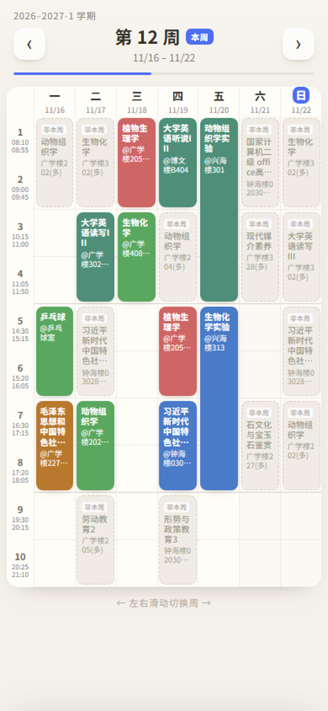

# 我的课表 · 手机版

一个纯静态的课程表网页：**本周高亮，左右滑动切换周次**，可以「添加到主屏幕」当 App 用。
没有后端、不用数据库、不联网也能跑。



```
timetable/
├─ parse.py              PDF 课表 → data.js 的解析脚本（只需要跑一次）
├─ data.js               生成的数据（课程 + 学期信息）
├─ index.html            页面骨架
├─ style.css             样式（配色、网格、卡片都在这里）
├─ app.js                逻辑（渲染、分栏、滑动手势、详情弹层）
├─ manifest.webmanifest  PWA 配置（图标、全屏、名字）
├─ sw.js                 离线缓存
├─ icons/                图标
└─ README.md             就是本文件
```

---

## 一、先跑起来看看

**电脑上**：直接双击 `index.html` 就能看（`data.js` 用的是 `<script>` 而不是 `fetch`，所以 `file://` 也能读）。

**手机上**（同一个 WiFi）：

```powershell
cd timetable
python -m http.server 8000
```

然后手机浏览器打开 `http://电脑的局域网IP:8000`。
电脑的 IP 用 `ipconfig` 看，一般是 `192.168.x.x`。这个方式**必须电脑开着**，只适合临时看。

**想随时随地看**（电脑关机也行）→ 见下面第四节。

---

## 二、课表数据是怎么来的

教务系统导出的 PDF 有两个坑：

1. 字体是 `Type0 / UniGB-UCS2-H`，而且**没有 ToUnicode 表** —— 所以 PyMuPDF、pdfplumber 抽出来全是乱码，OCR 又容易认错字。
2. 但它的正文其实就是 **UTF-16BE 字节**，躺在 PDF 内容流的 `(....) Tj` 里。

所以 `parse.py` 干的事很朴素：

| 步骤 | 做法 |
|---|---|
| 抠字 | 用 `zlib` 解开内容流，正则找 `Tm`（坐标）和 `Tj`（文字），按 UTF-16BE 解码 |
| 分列 | 文字的 x 坐标落在 7 个固定区间里 → 判断星期几 |
| 分课 | 同一门课的行距约 12pt，换课至少 15.5pt → 按 y 间距切块 |
| 拆字段 | `(1-2节)1-5周/校区:湖光校区/场地:广学楼302(多)` 用正则拆成节次、周次、教室 |
| 存盘 | 写成 `data.js` |

重新生成：

```powershell
python parse.py "你的课表.pdf"
```

> 只依赖 Python 标准库，不用 `pip install` 任何东西。

**周次规则**都写在 `parse.py` 的 `parse_weeks()` 里：`1-5周`、`2-8周(双)`、`第4周`、`5-7周(单),8周` 这些写法都能吃。

---

## 三、代码怎么读（按这个顺序看）

1. **`data.js`** — 先看数据长什么样。一门课就是一条记录：

   ```js
   { name: "植物生理学", day: 3, start: 1, end: 2,
     weeks: [5,7,8,11,12,...], place: "广学楼205(多)", campus: "湖光校区", online: false }
   ```

2. **`app.js` 的 `render()`** — 每次切周都重新画一遍：改标题日期、给今天加高亮、把 7 列清空重填。

3. **`clusterize()` + `placeCluster()`** — 这是整个项目唯一有点绕的地方：
   - 同一天里时间**重叠**的课先归成一簇（比如周三 1-2 节同时有「生物化学」和「植物生理学」）；
   - 簇里**本周要上**的课，按「泳道」并排分宽度（`left = lane / n * 100%`）；
   - 簇里**全是别的周**的课 → 只画一张灰色虚线卡，标签「非本周」。

   所以你截图里那些灰卡片，逻辑就是「这个格子有课，但不是这周」。

4. **手势** — `pointerdown / pointermove / pointerup` 三个事件：横向拖动超过 48px 就翻周，`board.style.transform` 跟着手指走一点点（乘 0.28 做阻尼），松手回弹。

5. **`formatWeeks()`** — 把 `[1,2,3,5]` 拼成 `1–3、5 周`，并把当前周标红。

另外支持一个调试用的参数：`index.html?w=8` 直接打开第 8 周（我截图对比数据时就靠它）。

---

## 四、部署到 GitHub Pages（手机随时能开）

1. 新建一个仓库，把 `timetable/` 里的文件推到**仓库根目录**（`index.html` 要在最外层）。
2. 仓库 → Settings → Pages → Source 选 `Deploy from a branch`，分支 `main`、目录 `/ (root)`，保存。
3. 等一两分钟，打开 `https://你的用户名.github.io/仓库名/`。

手机浏览器里再「分享 → 添加到主屏幕」，就有图标、全屏、离线可用（`sw.js` 会缓存）。

⚠️ **公开仓库 = 谁都能看**。`data.js` 里只有课程名、教室、周次，**没有姓名学号**，这点我处理过了。如果你后来手动加了个人信息，记得改用私有仓库 + Cloudflare Pages / Netlify，或者干脆别公开。

国内访问 GitHub Pages 有时会慢，打不开就换 Cloudflare Pages，代码一行都不用改。

> 改了 `style.css` / `app.js` 之后如果手机上还是旧样子，是 `sw.js` 的缓存：把里面的
> `const CACHE = "timetable-v1"` 改成 `v2` 再刷新即可。

---

## 五、想自己改的话

| 想改什么 | 改哪里 |
|---|---|
| 学期第一周的周一 | `parse.py` 里的 `"week1": "2026-08-31"`，改完重跑 |
| 一共几周 | `"totalWeeks": 20` |
| 作息时间 | `parse.py` 的 `PERIODS` |
| 卡片配色 | `app.js` 的 `PALETTE`（按课名哈希取色，同一门课永远同色） |
| 行高 / 圆角 / 字号 | `style.css` 的 `:root`（`--rowh` 要和 `app.js` 的 `ROW_H` 一起改） |
| 加「考试日程」之类的页 | 现在只有一屏，加 tab 的话在 `index.html` 里加一个 `<nav>`，用 `hidden` 切换 |

---

## 六、已知的小细节

- **广学楼 / 明德楼的 3-4 节是 10:05 上课，7-8 节是 16:25**（连上，取消课间），比其他楼早 10 / 5 分钟。课表里统一显示学校标准作息，没做楼栋区分。
- 「其他课程」里那几门（劳动教育、植物学实习、创新创业…）在 PDF 里没有排进格子，只有周次和老师，所以没有做进课表。
- 周次超出 1–20 会被夹住；假期里打开会停在第 20 周。
